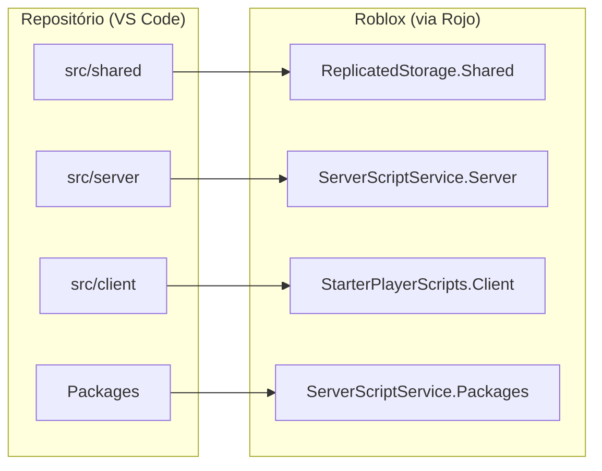
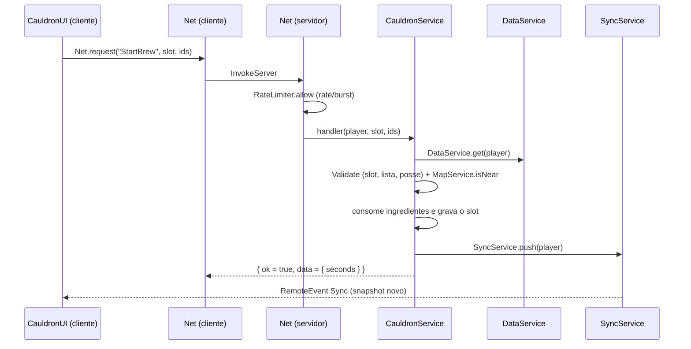
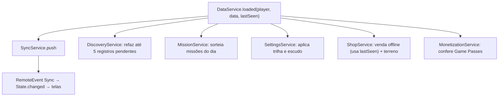

# Arquitetura técnica

> Revisão: 2026-10-17, commit `cf72d51`.

## Sumário
- [Visão geral](#visão-geral)
- [Pastas e mapeamento do Rojo](#pastas-e-mapeamento-do-rojo)
- [Inicialização do servidor](#inicialização-do-servidor)
- [Inicialização do cliente](#inicialização-do-cliente)
- [Comunicação cliente-servidor](#comunicação-cliente-servidor)
- [Sincronização de dados (snapshot)](#sincronização-de-dados-snapshot)
- [Módulos compartilhados](#módulos-compartilhados)
- [Dependências entre serviços](#dependências-entre-serviços)
- [Convenções de código](#convenções-de-código)

## Visão geral

- **O servidor é a autoridade.** Moedas, inventário, receitas, descobertas, trocas e compras são decididos e guardados **só no servidor**.
- **O cliente desenha e pede.** Ele mostra a interface e os efeitos visuais e manda **pedidos** por RemoteFunctions; o servidor valida tudo e responde.
- **O código é escrito em Luau `--!strict`** e sincronizado com o Roblox Studio pelo **Rojo**.
- **Os dados do jogador são salvos com o ProfileStore** ([Packages/ProfileStore.luau](../Packages/ProfileStore.luau)).
- **O mapa é gerado por código** quando o servidor inicia ([MapService.luau](../src/server/Services/MapService.luau), [ShopService.luau](../src/server/Services/ShopService.luau)). O lugar no Studio pode estar vazio.

## Pastas e mapeamento do Rojo

O arquivo [default.project.json](../default.project.json) diz onde cada pasta aparece no Roblox:

| Pasta no repositório | Onde aparece no Roblox | Conteúdo | Quem enxerga |
|---|---|---|---|
| `src/shared` | `ReplicatedStorage.Shared` | Config, Locale, Util, Types | Servidor e cliente |
| `src/server` | `ServerScriptService.Server` | Services, Config secreta, Util, Net, Main | Só o servidor |
| `src/client` | `StarterPlayer.StarterPlayerScripts.Client` | UI, Controllers, Net, State, Main | Só o cliente |
| `Packages` | `ServerScriptService.Packages` | ProfileStore (copiado, versão fixa) | Só o servidor |

**Configurações secretas ficam no servidor:** [src/server/Config/](../src/server/Config/) tem as receitas fixas, as palavras do gerador de nomes e as receitas secretas da semana. Assim um jogador não consegue descobrir receitas lendo os arquivos do cliente.

### Arquivos por pasta

| Pasta | Arquivos |
|---|---|
| [src/server/Services/](../src/server/Services/) | CauldronService, CometService, DataService, DebugService, DiscoveryService, EffectService, FriendService, FriendshipService, IngredientService, MapService, MissionService, MonetizationService, MutationService, PotionService, RebirthService, RecipeService, RewardService, SettingsService, ShopService, SplashService, SyncService, TradeService, UpgradeService, WeatherService |
| [src/server/Util/](../src/server/Util/) | RateLimiter, Validate |
| [src/server/](../src/server/) | [Main.server.luau](../src/server/Main.server.luau), [Net.luau](../src/server/Net.luau), [Announce.luau](../src/server/Announce.luau) |
| [src/client/UI/](../src/client/UI/) | Banner, CauldronUI, Components, DailyUI, DebugUI, FriendshipUI, GrimoireUI, HUD, InventoryUI, MarketUI, MenuUI, MissionsUI, Page, RebirthUI, RevealPopup, Router, SettingsUI, ShopUI, SocialUI, StoreUI, Theme, Toast, TradeUI, UpgradeUI |
| [src/client/Controllers/](../src/client/Controllers/) | CometController, EffectController, SplashController, StationController, WeatherController |
| [src/client/](../src/client/) | [Main.client.luau](../src/client/Main.client.luau), [Net.luau](../src/client/Net.luau), [State.luau](../src/client/State.luau) |
| [src/shared/Config/](../src/shared/Config/) | Comet, Daily, Debug, Economy, Ingredients, Missions, Monetization, Mutations, Rarities, Rebirth, Remotes, Shop, Social, Traits, Upgrades, Weather |
| [src/shared/Util/](../src/shared/Util/) | Describe, Format, Hash, OrderMatch, PlayerStats, RecipeKey, Signal |
| [src/shared/](../src/shared/) | [Types.luau](../src/shared/Types.luau), [Locale/](../src/shared/Locale/) (init, ptBR, en) |

## Inicialização do servidor

[Main.server.luau](../src/server/Main.server.luau) faz `require` de todos os serviços e chama `init()` **nesta ordem**:

1. `MapService`: gera o lobby, as estações, a zona segura do lobby e o Caldeirão da Amizade.
2. `SyncService`: registra o `GetSnapshot` e passa a ouvir o `DataService.loaded`.
3. `EffectService`
4. `IngredientService`
5. `UpgradeService`
6. `WeatherService`: começa o ciclo de clima.
7. `DiscoveryService`: abre as DataStores globais e o MessagingService e inicia as filas.
8. `FriendService`
9. `MissionService`
10. `SettingsService`
11. `CauldronService`
12. `PotionService`
13. `SplashService`
14. `ShopService`: cria os 6 terrenos de loja e o ciclo de clientes.
15. `TradeService`
16. `FriendshipService`
17. `RebirthService`
18. `MonetizationService`: define `MarketplaceService.ProcessReceipt`.
19. `CometService`: começa o ciclo do cometa.
20. `DebugService`: só registra o Remote `Debug` se `Debug.enabled()` for verdadeiro.
21. `DataService`: **por último**. Começa a carregar os jogadores, com todos os serviços já ouvindo `DataService.loaded`.

Quando os dados de um jogador terminam de carregar, `DataService` dispara `loaded(player, data, lastSeen)`. Esses serviços reagem: `SyncService`, `DiscoveryService`, `MissionService`, `SettingsService`, `ShopService` e `MonetizationService`.

## Inicialização do cliente

[Main.client.luau](../src/client/Main.client.luau):
1. Espera `game.Loaded`, para garantir que `ReplicatedStorage` já chegou.
2. Cria duas `ScreenGui`:
   - `PotionParty`, com `DisplayOrder = 1`, para o HUD e as janelas;
   - `PotionPartyOverlay`, com `DisplayOrder = 10`, para a revelação, os avisos e os banners.
3. Monta as telas na ordem: HUD, Cauldron, Inventory, Market, Upgrade, Grimoire, Menu, Missions, Daily, Social, Shop, Trade, Friendship, Rebirth, Store, Settings, Debug, RevealPopup, Toast, Banner.
4. Inicia os controladores: Station, Effect, Weather, Comet e Splash.
5. Chama `State.start()`, que pede o primeiro snapshot.

O idioma está fixo em português: `AUTO_DETECT_LANGUAGE = false` em [Main.client.luau](../src/client/Main.client.luau).

**Navegação:** [Router.luau](../src/client/UI/Router.luau) garante uma janela aberta por vez. [Page.luau](../src/client/UI/Page.luau) cria janelas padrão registradas no Router, e [Components.luau](../src/client/UI/Components.luau) tem os construtores de interface (`UI.new`, `UI.button`, `UI.label`, `UI.list`, `UI.panel`…).

## Comunicação cliente-servidor

Todos os Remotes ficam em `ReplicatedStorage.Remotes`. Essa pasta é criada por [src/server/Net.luau](../src/server/Net.luau) quando o servidor inicia.

**RemoteFunctions (o cliente pede, o servidor responde):** 28 no total.
- `Net.onInvoke(nome, handler)` envolve cada handler com:
  1. **limite de frequência** ([RateLimiter.luau](../src/server/Util/RateLimiter.luau), um "balde de fichas" por jogador e por Remote, configurado em [Remotes.luau](../src/shared/Config/Remotes.luau));
  2. `pcall` (um erro vira `error.generic`, sem travar o cliente);
  3. resposta padrão `{ ok, err, data }` (tipo `Result` em [Types.luau](../src/shared/Types.luau)). `err` é uma **chave de texto** do Locale.
- Cada handler valida os próprios argumentos com [Validate.luau](../src/server/Util/Validate.luau) e, quando a ação depende de lugar, confere a distância.
- No cliente, [src/client/Net.luau](../src/client/Net.luau) oferece `Net.invoke` (silencioso) e `Net.request` (mostra o erro traduzido num toast vermelho).

**RemoteEvents (o servidor avisa):** `Sync`, `Announce`, `Transformed`, `Splash`, `Trade` e `Friendship`. O cliente **nunca** dispara RemoteEvents para o servidor.

Lista completa dos Remotes e das validações: [SECURITY_AND_MONETIZATION.md](SECURITY_AND_MONETIZATION.md#remotes-e-validações).

Exemplo: começar um preparo.

## Sincronização de dados (snapshot)

- Quando um serviço muda os dados de um jogador, chama `SyncService.push(player)`. Vários `push` no mesmo frame viram **um** envio (`task.defer`).
- **O snapshot** ([Types.luau](../src/shared/Types.luau), tipo `Snapshot`) leva:
  - `data`: o perfil inteiro do jogador;
  - `recipes`: `RecipeInfo` de cada receita que o jogador tem no inventário ou no Grimório;
  - `serverTime`;
  - `session`: informações que não são salvas, preenchidas por "provedores" registrados com `SyncService.addSessionProvider`:
    - `friends` (FriendService),
    - `plot` (ShopService),
    - `orders` (ShopService).
- No cliente, [State.luau](../src/client/State.luau) guarda o último snapshot e dispara `State.changed`; as telas redesenham ao receber esse sinal.
- O tamanho do snapshot cresce com o número de receitas descobertas. É o problema **P5**, ver [KNOWN_ISSUES.md](KNOWN_ISSUES.md).

## Módulos compartilhados
| Módulo | Responsabilidade |
|---|---|
| [Types.luau](../src/shared/Types.luau) | Todos os tipos: perfil, receitas, pedidos, troca, snapshot… |
| [PlayerStats.luau](../src/shared/Util/PlayerStats.luau) | Contas derivadas do perfil: caldeirões, capacidade, multiplicadores, tempo de preparo, preço de venda, sorte, clientes. O servidor e o cliente usam a **mesma** conta; quem decide é o servidor. |
| [RecipeKey.luau](../src/shared/Util/RecipeKey.luau) | Chave da receita (ids ordenados e unidos por `\|`), chave da pilha (`receita#mutação`) e contagem de combinações. |
| [Hash.luau](../src/shared/Util/Hash.luau) | FNV-1a 32 bits, usado como semente determinística das receitas. |
| [OrderMatch.luau](../src/shared/Util/OrderMatch.luau) | Se uma poção atende um pedido de cliente e o texto do pedido. |
| [Describe.luau](../src/shared/Util/Describe.luau), [Format.luau](../src/shared/Util/Format.luau) | Textos de efeito, números e tempos. |
| [Signal.luau](../src/shared/Util/Signal.luau) | Sinal simples entre módulos. |
| [Locale/](../src/shared/Locale/) | `Locale.t(chave, parâmetros)`: português padrão, inglês parcial. |

## Dependências entre serviços

- A ordem de `require` entre os serviços **não tem ciclos**. Isso foi conferido com `tsort` nesta revisão ([TEST_RESULTS.md](TEST_RESULTS.md#b-verificações-executadas-nesta-revisão)).
- **Base:** quase todos os serviços dependem de `DataService` (dados), `SyncService` (envio ao cliente) e `Net` (Remotes).
- **Moedas ganhas** passam por `RewardService` (bônus de amigos e missão "earn").
- **Recompensas fixas** (missões, diária) somam moedas direto.
- **Exceção:** `SyncService` não pode depender de serviços que chamam `SyncService.push`. Por isso existem os provedores de sessão.

## Convenções de código
- Todo arquivo começa com `--!strict`: 91 de 91 arquivos em `src/` nesta revisão.
- Nomes de código em inglês; comentários e textos em português.
- Formatação com StyLua ([stylua.toml](../stylua.toml): tabs, 120 colunas) e lint com Selene ([selene.toml](../selene.toml): `std = "roblox"`).
- Textos visíveis sempre via `Locale.t`. O servidor responde **chaves** de texto, nunca frases prontas, exceto os nomes de receitas e de clientes.
- Placeholders visuais marcados com `TODO(asset)`: 19 ocorrências nesta revisão.
