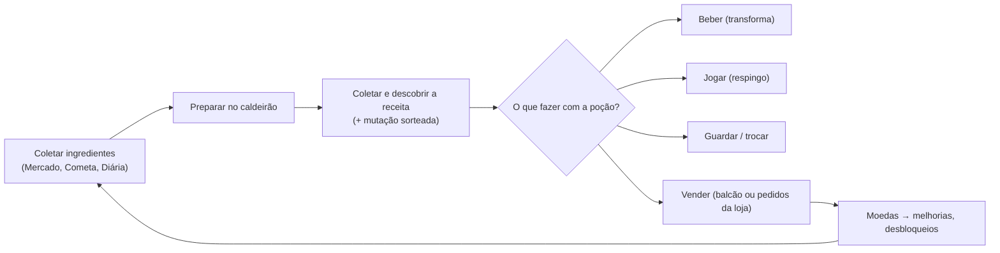

# Sistemas de gameplay

> Revisão: 2026-10-17, commit `cf72d51`. **Os números abaixo foram lidos das configurações desse commit.** Se uma configuração mudar, o arquivo de configuração vale mais que este documento.

## Sumário
- [Ciclo principal](#ciclo-principal)
- [Mapa](#mapa)
- [Ingredientes](#ingredientes)
- [Receitas](#receitas)
- [Caldeirão](#caldeirão)
- [Poções: beber, jogar, guardar, vender](#poções-beber-jogar-guardar-vender)
- [Efeitos de transformação](#efeitos-de-transformação)
- [Mutações](#mutações)
- [Clima](#clima)
- [Grimório, descoberta mundial, ranking e segredos](#grimório-descoberta-mundial-ranking-e-segredos)
- [Cometa](#cometa)
- [Loja e clientes NPC](#loja-e-clientes-npc)
- [Venda offline](#venda-offline)
- [Melhorias e economia](#melhorias-e-economia)
- [Respingo, escudo e zonas seguras](#respingo-escudo-e-zonas-seguras)
- [Trocas](#trocas)
- [Caldeirão da Amizade](#caldeirão-da-amizade)
- [Amigos, visitas e curtidas](#amigos-visitas-e-curtidas)
- [Diária e missões](#diária-e-missões)
- [Novo Mestre (rebirth)](#novo-mestre-rebirth)
- [Interface](#interface)
- [Onde mexer no balanceamento](#onde-mexer-no-balanceamento)
- [Como adicionar ingredientes e receitas](#como-adicionar-ingredientes-e-receitas)

## Ciclo principal



## Mapa

O mapa é gerado por código ([MapService.luau](../src/server/Services/MapService.luau), [ShopService.luau](../src/server/Services/ShopService.luau)).

| Lugar | Posição | Observação |
|---|---|---|
| Caldeirão | (0, 0, -20) | Prompt "Preparar poções" |
| Balcão de Vendas | (24, 0, -12) | Prompt abre o Inventário |
| Mercado | (-24, 0, -12) | Comprar e liberar ingredientes |
| Caldeirão da Amizade | (0, 0, -44) | Dois lados (A e B) |
| Zona segura do lobby | centro (0, 10, -18), tamanho 90×20×64 | Piso verde translúcido |
| Queda do Cometa | (0, 0, 34) | Fora da zona segura |
| 6 terrenos de loja | x = ±95; z = -60, 0, 60 | Cada terreno é uma zona segura de 44×16×44 |

Se o lugar não tiver uma peça `Baseplate`, o servidor cria chão e SpawnLocation.

## Ingredientes

Fonte: [Ingredients.luau](../src/shared/Config/Ingredients.luau) e [Rarities.luau](../src/shared/Config/Rarities.luau).

| Grupo | Ingredientes | Preço / valor na poção / custo para liberar |
|---|---|---|
| Básicos (liberados, 5 de cada no início) | Cogumelo, Pena, Pimenta, Gelo, Mel, Pedra (Comuns) | 10 / 8 / 0 |
| Incomuns | Raio, Nuvem (liberar: 250); Bolha, Pizza (liberar: 300) | 35 / 22 |
| Raros | Lua, Lava (liberar: 1000); Ímã (liberar: 1200) | 90 / 55 |
| Épicos | Fantasma (liberar: 4000); Estrela (liberar: 4500) | 220 / 130 |
| Lendário | Arco-íris (liberar: 15000) | 600 / 340 |
| Só do Cometa | Poeira de Cometa (Lendário, `cometOnly`) | não é vendido / 400 |

- **"Liberar"** dá o direito de **comprar** no Mercado e ganhar 3 unidades de bônus (`unlockBonusAmount`).
- **Para preparar basta ter o ingrediente**, mesmo bloqueado (por exemplo, ingredientes vindos do Cometa ou da Diária).
- **Cada ingrediente tem "traits"** (atributos com peso) que definem o efeito da poção. Os 22 traits estão em [Traits.luau](../src/shared/Config/Traits.luau), divididos em 4 categorias:
  - tamanho: Gigante, Mini;
  - forma: Sapo, Fantasma, Pedra, Nuvem, Robô, Pizza;
  - movimento: Voar, Flutuar, Quicar, Correr Rápido, Câmera Lenta;
  - visual: Brilhar, Fogo Mágico, Purpurina, Nevar, Choquinho, Bolhas, Arco-íris, Cósmico, Aura Dourada.
- A "Aura Dourada" só aparece pela mutação Dourada.

## Receitas

Fonte: [RecipeService.luau](../src/server/Services/RecipeService.luau), [RecipeKey.luau](../src/shared/Util/RecipeKey.luau) e [Recipes.luau](../src/server/Config/Recipes.luau).

**Chave da receita:** os ids dos ingredientes em ordem alfabética, unidos por `|`. A ordem em que o jogador escolhe não importa, e repetir ingredientes é permitido (`Mushroom|Mushroom`). Uma poção mutada fica numa pilha separada: `Cloud|Feather|Pepper#Golden`.

**Determinismo:** a mesma chave gera **sempre** a mesma poção em qualquer servidor. Os desempates e o nome usam `Random.new(Hash.fnv1a(chave))`.

**Receita procedural** (toda combinação que não está em `Recipes.luau`):
1. Soma os pesos dos traits de todos os ingredientes.
2. Em cada categoria vence o trait de maior peso, se o peso for pelo menos `traitThreshold = 2`. Empates são decididos pela semente da receita.
3. Se nenhuma categoria passar do limite, o trait mais forte entra mesmo assim.
4. O nome é montado como `{prefixo} {sujeito} {complemento}` (ex.: "Poção do Pato Turbo"), com as palavras de [NameParts.luau](../src/server/Config/NameParts.luau). Duas receitas diferentes podem acabar com o mesmo nome.

**Receitas fixas:** são **17**, e substituem o resultado procedural.
- 5 só com básicos. Ex.: Pena + Mel = "Poção da Abelha Rainha".
- 6 com desbloqueáveis.
- 2 com Poeira de Cometa.
- 4 de 4 ingredientes, só no Caldeirão da Amizade.

**Valor da poção:**
- Fórmula: `soma(valor na poção dos ingredientes) × comboMultiplier[nº de ingredientes]`, com `comboMultiplier = {1; 1,4; 1,9; 2,6}`.
- Receitas fixas multiplicam por `specialRecipeMultiplier = 2`, ou pelo `valueMultiplier` próprio (3, 4 ou 5 em algumas).
- O resultado é arredondado.

**Três números que não devem ser confundidos:**

| Conceito | Quantidade | De onde vem |
|---|---|---|
| Combinações possíveis no caldeirão normal (17 ingredientes, 1 a 3 por receita, com repetição) | **1.139** | `RecipeKey.totalCombinations`; é o total mostrado no Grimório |
| Combinações com só os 6 básicos (o que um jogador novo alcança) | 83 | mesma fórmula com 6 ingredientes |
| Combinações de 4 ingredientes (só no Caldeirão da Amizade) | 4.845 | C(20,4); não entram no total do Grimório (P14) |
| **Receitas fixas** escritas à mão | **17** | [Recipes.luau](../src/server/Config/Recipes.luau) |
| **Receitas secretas da semana** | 3 sorteadas por semana, de uma lista de 12 | [SecretRecipes.luau](../src/server/Config/SecretRecipes.luau) |

Toda combinação válida gera uma poção com nome e efeito. As fixas são os momentos especiais, e as secretas são um desafio semanal com dica.

## Caldeirão

Fonte: [CauldronService.luau](../src/server/Services/CauldronService.luau), [PlayerStats.luau](../src/shared/Util/PlayerStats.luau) e [CauldronUI.luau](../src/client/UI/CauldronUI.luau).

- **Ingredientes:** de 1 a 3 por preparo.
- **Tempo de preparo:** `(3 + soma do brewSeconds de cada ingrediente) × 0,9^nível de Fogo Rápido`, arredondado para cima, com mínimo de 1 s. O `brewSeconds` por raridade é: Comum 2, Incomum 6, Raro 12, Épico 25, Lendário 45.
- **O preparo continua com o jogador offline:** o servidor guarda só o horário em que fica pronto.
- **Ao coletar:**
  - sorteia a mutação, com o clima daquele momento;
  - coloca a poção no inventário, se houver espaço;
  - registra a descoberta, se a receita é nova;
  - confere se é uma receita secreta da semana.
- **Quantidade de caldeirões:** `1 + nível de Caldeirão Extra + 1 se tiver o Game Pass`.
- **Caldeirão "sobrando" (4B.1):** um caldeirão que ficou com preparo depois de perder o pass (ou outra redução) continua visível e coletável, mas não aceita preparo novo.

## Poções: beber, jogar, guardar, vender

| Ação | Onde | Regra principal |
|---|---|---|
| Beber | Qualquer lugar | Aplica o efeito; substitui o efeito atual. |
| Jogar (respingo) | Fora de zona segura | Veja [Respingo](#respingo-escudo-e-zonas-seguras). |
| Guardar | — | Capacidade: `20 + 10 × nível de Prateleira Maior`. |
| Vender no balcão | Perto do Balcão (16 studs) | Preço = valor × mutação × multiplicador de venda × bônus de amigos. |
| Entregar na loja | Perto do balcão **da sua loja** (22 studs) | Veja [Loja](#loja-e-clientes-npc). |

## Efeitos de transformação

Fonte: [EffectService.luau](../src/server/Services/EffectService.luau) e [EffectController.luau](../src/client/Controllers/EffectController.luau).

- **Um efeito por jogador.** Beber outra poção remove o efeito anterior.
- **Duração:** `25 s + 8 s × (raridade − 1)` por ingrediente. A mutação pode multiplicar ou fixar a duração. Respingo dura 8 s.
- **Aplicação** (sempre no servidor): tamanho com `Model:ScaleTo`, forma (cor, material e peças decorativas), movimento (velocidade, pulo, força antigravidade), visual (luz, fogo, partículas, Highlight) e o traço extra da mutação.
- **Remoção:** cada mudança guarda uma função de "desfazer". Elas rodam na ordem inversa, cada uma protegida por `pcall`, quando o tempo acaba, quando o jogador bebe outra poção ou quando o personagem é removido (morte ou saída).
- **No cliente:** voo segurando o pulo, animação de cor do arco-íris e a "bolha" de transformação, que é visível para todos (evento `Transformed`).

## Mutações

Fonte: [Mutations.luau](../src/shared/Config/Mutations.luau) e [MutationService.luau](../src/server/Services/MutationService.luau).

- **Quando:** ao **coletar** do caldeirão (e no Caldeirão da Amizade). Decisão D02.
- **Ordem do sorteio:** da mais rara para a mais comum; para na primeira que acertar.
- **Chance de cada uma:** `chance configurada × sorte`.
  - Sorte normal = 1.
  - Sorte VIP = 2 (Game Pass `VipLuck`).
  - Caldeirão da Amizade entre amigos do Roblox: ×1,5.

| Mutação | Chance configurada | Preço | Efeito ao beber | Condição |
|---|---|---|---|---|
| Arco-íris | 0,1% | ×20 | duração ×2 + brilho arco-íris | — |
| Eterna | 0,4% | ×6 | dura 900 s | — |
| Dourada | 1% | ×5 | aura dourada | — |
| Dupla | 3% | ×2 | duração ×2 | — |
| Eletrificada | 25% | ×2,5 | choquinho | só na Tempestade |
| Assombrada | 25% | ×3 | forma fantasma | só na Lua Cheia |

**Chance real por poção coletada** (a ordem do sorteio reduz um pouco as menos raras). Valores calculados na análise de 2026-10-17 ([TEST_RESULTS.md](TEST_RESULTS.md#e-análises-e-cálculos)):

| | Céu limpo, normal | Céu limpo, VIP | Tempestade ou Lua Cheia, normal | Tempestade ou Lua Cheia, VIP |
|---|---|---|---|---|
| Arco-íris | 0,100% | 0,200% | 0,100% | 0,200% |
| Eterna | 0,400% | 0,798% | 0,400% | 0,798% |
| Dourada | 0,995% | 1,980% | 0,995% | 1,980% |
| Dupla | 2,955% | 5,821% | 2,955% | 5,821% |
| Eletrificada ou Assombrada | – | – | 23,888% | 45,600% |
| Nenhuma | 95,550% | 91,200% | 71,663% | 45,600% |

**DEBUG:** a próxima mutação pode ser forçada (`MutationService.forceNext`), só no [TEST].

## Clima

Fonte: [Weather.luau](../src/shared/Config/Weather.luau), [WeatherService.luau](../src/server/Services/WeatherService.luau) e [WeatherController.luau](../src/client/Controllers/WeatherController.luau).

- **Ciclo:** céu limpo por um tempo sorteado entre 180 e 300 s, depois um evento (Tempestade ou Lua Cheia, peso 1 cada) por 150 s, e de volta ao céu limpo.
- **Estado:** fica em atributos do `Workspace` (`PP_Weather`, `PP_WeatherEndsAt`).
- **No cliente:** muda o `Lighting` com uma transição, mostra chuva com relâmpagos ou luzinhas roxas e exibe um banner.
- **No Studio**, os tempos ficam 4x mais curtos (`Debug.studioTimeScale = 0.25`).

## Grimório, descoberta mundial, ranking e segredos

Fonte: [DiscoveryService.luau](../src/server/Services/DiscoveryService.luau) e [GrimoireUI.luau](../src/client/UI/GrimoireUI.luau).

**Grimório pessoal:** `data.discovered[chave] = { t, by, byId, first }`.

**Descoberta mundial:**
- Na 1ª vez que alguém cria uma receita, o servidor tenta gravar essa pessoa como dona numa DataStore global (`PotionParty_WorldDiscoveries_v1`), usando `UpdateAsync`, que só grava se ainda não houver dono.
- Isso roda numa fila que respeita o limite do DataStore.
- **Anúncio:** sai para todos os servidores via MessagingService (tópico `PP_WorldDiscovery`), só quando **esta** chamada gravou o registro (4B.1, P9).
  - Cada servidor publica no máximo 1 anúncio a cada 3 s, com fila de até 20.
  - Cada servidor mostra no máximo 8 anúncios por minuto vindos de outros servidores.
- **Pendências:** sem API Services, a receita fica "Registrando…". Ao entrar, até 5 registros pendentes são tentados de novo.

**Ranking:**
- OrderedDataStore `PotionParty_DiscoveryRanking_v1`, com o **total de receitas no Grimório** (decisão D01).
- Atualizado a cada 60 s para quem descobriu algo, e ao sair.
- Mostra o top 20, com cache de 60 s.

**Receitas secretas da semana:**
- 3 sorteadas a partir da lista de 12, usando o número da semana como semente. A semana começa segunda-feira, 00:00 UTC.
- O jogador vê só a dica.
- Criar uma delas paga 400 moedas, uma vez por receita por semana.

## Cometa

Fonte: [Comet.luau](../src/shared/Config/Comet.luau), [CometService.luau](../src/server/Services/CometService.luau) e [CometController.luau](../src/client/Controllers/CometController.luau).

- **Linha do tempo:** um cometa a cada 600 s (150 s no Studio), com aviso 15 s antes, queda de 3 s e 90 s no chão.
- **Itens espalhados:** `6 + 2 por jogador`, no máximo 20, num anel de raio 8 a 34 ao redor da queda.
  - Pesos por raridade: Incomum 60, Raro 30, Épico 10.
  - Quem encostar primeiro leva (D04). Desde a 4B.2 o servidor exige personagem vivo e distância de até **10 studs** (P4).
- **Núcleo de energia:**
  - Energia necessária: `20 + 15 por jogador`.
  - Cada toque no prompt vale +1, com intervalo de 0,35 s por jogador e distância de até 20 studs.
  - Se encher, quem deu **3 toques ou mais** ganha 1 Poeira de Cometa.

## Loja e clientes NPC

Fonte: [ShopService.luau](../src/server/Services/ShopService.luau), [Shop.luau](../src/shared/Config/Shop.luau), [OrderMatch.luau](../src/shared/Util/OrderMatch.luau) e [ShopUI.luau](../src/client/UI/ShopUI.luau).

- **Terrenos:** cada jogador recebe um terreno ao entrar (máximo de **6** por servidor; quem passar disso fica sem loja e o Output avisa).
- **Clientes:** chegam a cada 20 s, enquanto o dono está online, até `2 + nível de Prateleiras Extras + 2 com o pass Loja Maior`. Cada um espera 120 s.
- **Pedidos** (sempre possíveis com o que o jogador já descobriu):
  - **por tipo** (chance de 45%, se houver receitas descobertas): uma receita exata, paga ×1,5;
  - **especial**: dois traits de uma mesma receita descoberta, paga ×2,5. Chance de `15% + 5% × nível de Vitrine Mágica`;
  - **por efeito**: um trait, paga ×1,3. Sem descobertas, sorteia entre Gigante, Mini, Voar, Brilhar e Correr Rápido.
- **Pagamento:** preço de venda da poção entregue (com mutação) × multiplicador do pedido × bônus de amigos.
- **Game Pass Auto-venda:** o servidor entrega sozinho a poção **mais barata** que atende cada pedido.

## Venda offline

Fonte: [ShopService.luau](../src/server/Services/ShopService.luau) (`ShopService.offlineSales`) e [DataService.luau](../src/server/Services/DataService.luau).

- **Ritmo:** 1 poção a cada 300 s fora do jogo, contando no máximo 4 h.
- **Tetos:** 20 poções e 5000 moedas por volta. O pass Auto-venda dobra os dois tetos.
- **Preço e escolha:** vende a 60% do preço, só poções **sem mutação**, das mais baratas para as mais caras.
- **O tempo offline vem do `lastSeen`**, entregue pelo `DataService.loaded`. Detalhes da proteção contra pagamento duplo: [DATA_AND_PERSISTENCE.md](DATA_AND_PERSISTENCE.md#lastlogout-e-a-venda-offline-correção-p3).
- **Futuro:** uma prateleira dedicada, em que o jogador escolhe o que vender (D09, ainda não implementada).

## Melhorias e economia

Fonte: [Upgrades.luau](../src/shared/Config/Upgrades.luau), [Economy.luau](../src/shared/Config/Economy.luau) e [PlayerStats.luau](../src/shared/Util/PlayerStats.luau).

| Melhoria | Efeito por nível | Máx. | Preço |
|---|---|---|---|
| Fogo Rápido (`BrewSpeed`) | tempo ×0,9 | 10 | 150 × 1,6^nível |
| Caldeirão Extra (`ExtraCauldron`) | +1 caldeirão | 3 | 500, 2500, 10000 |
| Prateleira Maior (`Storage`) | +10 de capacidade | 10 | 100 × 1,5^nível |
| Vitrine Brilhante (`SellPrice`) | +10% no preço de venda | 10 | 200 × 1,7^nível |
| Prateleiras Extras (`ShopShelves`) | +1 cliente simultâneo | 5 | 300 × 1,8^nível |
| Vitrine Mágica (`ShopShowcase`) | +5% de pedidos especiais | 5 | 400 × 1,9^nível |

- **Início:** 100 moedas, 5 de cada básico e 20 de capacidade.
- **Multiplicador de venda:** `(1 + 0,1 × Vitrine Brilhante) × (1 + 0,5 × rebirths)`.
- **Bônus de amigos:** +10% por amigo do Roblox no servidor, até +50%. É aplicado no servidor por [RewardService.luau](../src/server/Services/RewardService.luau) nas vendas e nos pedidos.

## Respingo, escudo e zonas seguras

Fonte: [SplashService.luau](../src/server/Services/SplashService.luau), [SplashController.luau](../src/client/Controllers/SplashController.luau) e [Social.luau](../src/shared/Config/Social.luau).

- **Mira:** automática no jogador mais próximo, até 40 studs (com 6 de folga no servidor). Sem alvo, o frasco cai à frente.
- **Tempo:** voo de 0,6 s e intervalo de 2 s entre arremessos.
- **Impacto:** atinge quem estiver a até 7 studs e transforma por 8 s (pode substituir uma Eterna, D05).
- **Bloqueios**, todos conferidos no servidor:
  - não dá para jogar de dentro de uma zona segura;
  - um alvo dentro de zona segura **ou** com Modo Escudo é poupado, e quem jogou é avisado;
  - **imunidade de 10 s** depois de ser atingido (4B.2, D06). Não impede beber as próprias poções;
  - quem joga nunca se atinge.
- **Modo Escudo:** em Ajustes, salvo em `data.settings.shield`.

## Trocas

Fonte: [TradeService.luau](../src/server/Services/TradeService.luau) e [TradeUI.luau](../src/client/UI/TradeUI.luau).

- **O que pode ser trocado:** só poções e ingredientes (moedas não). Até 6 tipos de item por lado.
- **Fluxo:** convite (expira em 20 s) → as duas ofertas visíveis o tempo todo → **Pronto** dos dois → 3 s de espera → **Confirmar** dos dois.
- **Qualquer mudança de oferta** desmarca o "Pronto" dos dois.
- **Cancelamento:** se um item oferecido sumir do inventário (checagem a cada 1 s), se alguém sair do jogo ou se não couber na prateleira de quem recebe.
- **A troca acontece em memória de uma vez só** e depois pede salvamento dos dois perfis. **Não é durável em crash** (P1, risco aceito D12).
- **Interruptor:** `Social.tradingEnabled` (D11). Com `false`, o botão some e o servidor recusa.
- **Ainda não existe** regra de itens pagos nem PolicyService (P2, planejado para a 4B.3).

## Caldeirão da Amizade

Fonte: [FriendshipService.luau](../src/server/Services/FriendshipService.luau) e [FriendshipUI.luau](../src/client/UI/FriendshipUI.luau).

- **Participação:** dois lados (A e B). Cada jogador entra pelo prompt de um lado e escolhe 2 ingredientes.
- **Preparo:** os dois marcam "Pronto"; a mistura de 4 ingredientes sai na hora e **os dois** ganham a poção, cada um com o próprio sorteio de mutação.
- **Amigos do Roblox:** sorte de mutação ×1,5.
- **Saída automática:** quem se afasta mais de 14 studs sai do lado.
- **4B.1 (P10):** a checagem de amizade acontece antes de gastar ingredientes, e o estado é conferido de novo depois dela.

## Amigos, visitas e curtidas

- **Visitar:** **Menu → Jogadores → Visitar** teleporta para a entrada da loja do outro jogador. Conta 1 visita por visitante por sessão.
- **Curtir:** pelo prompt na placa da loja, 1 vez por loja por dia (dia UTC). A placa mostra ❤️ e 👀.
- **Bônus de amigos:** veja [Melhorias e economia](#melhorias-e-economia).

## Diária e missões

Fonte: [MissionService.luau](../src/server/Services/MissionService.luau), [Missions.luau](../src/shared/Config/Missions.luau) e [Daily.luau](../src/shared/Config/Daily.luau).

- **O dia** é o dia UTC (`os.time() // 86400`), com virada às 00:00 UTC, que é 21:00 em Brasília (D03).
- **Diária:**
  - 7 prêmios em ciclo: 100, 150, 200 (+ingredientes), 300, 400 (+ingredientes), 500 e 1000 (+ingredientes);
  - entrar no dia seguinte continua a sequência; pular um dia volta ao dia 1.
- **Missões:**
  - 3 por dia, sorteadas com a semente `UserId + dia`, então sair e voltar não troca as missões;
  - tipos: preparar, vender, descobrir, beber, atender clientes, respingar, pegar do Cometa e ganhar moedas;
  - prêmio mínimo de 50.

## Novo Mestre (rebirth)

Fonte: [RebirthService.luau](../src/server/Services/RebirthService.luau) e [Rebirth.luau](../src/shared/Config/Rebirth.luau).

- **Custo:** `25000 × 3^rebirths`.
- **Prêmio:** multiplicador de moedas `1 + 0,5 × rebirths`.
- **Reinicia** moedas (volta a 100) e melhorias.
- **Mantém** receitas, Grimório, poções, ingredientes, cosméticos e passes.
- **Exige** todos os caldeirões vazios.

## Interface

- **HUD:**
  - moedas;
  - efeito ativo;
  - fichinhas de clima, cometa, clientes na loja, zona segura ou escudo, e bônus de amigos;
  - 4 botões: Poções, Grimório, Melhorias e Menu (com "!" quando há prêmio a pegar).
- **Menu:** Missões, Diária, Minha Loja, Jogadores, Novo Mestre, Loja VIP e Ajustes.
- **Janelas abertas pelo mapa:** Caldeirão, Mercado, Inventário (no Balcão), pedidos da Loja (no balcão da sua loja) e Caldeirão da Amizade.
- **Camada de cima:** revelação da poção, toasts e banners.
- **Idiomas:** português completo; inglês com 20 chaves ([en.luau](../src/shared/Locale/en.luau)). As chaves que faltam caem no português.
- **Tutorial:** não existe ainda (D10, Fase 4B.5).

## Onde mexer no balanceamento

| O quê | Arquivo |
|---|---|
| Ingredientes (preço, raridade, traits) | [Ingredients.luau](../src/shared/Config/Ingredients.luau) |
| Raridades e tempo de preparo extra | [Rarities.luau](../src/shared/Config/Rarities.luau) |
| Traits e intensidade dos efeitos | [Traits.luau](../src/shared/Config/Traits.luau) |
| Moedas iniciais, durações, multiplicadores, distâncias | [Economy.luau](../src/shared/Config/Economy.luau) |
| Melhorias e preços | [Upgrades.luau](../src/shared/Config/Upgrades.luau) |
| Limite de chamadas por segundo | [Remotes.luau](../src/shared/Config/Remotes.luau) |
| Receitas especiais | [Recipes.luau](../src/server/Config/Recipes.luau) |
| Palavras do gerador de nomes | [NameParts.luau](../src/server/Config/NameParts.luau) |
| Receitas secretas da semana | [SecretRecipes.luau](../src/server/Config/SecretRecipes.luau) |
| Mutações | [Mutations.luau](../src/shared/Config/Mutations.luau) |
| Clima | [Weather.luau](../src/shared/Config/Weather.luau) |
| Cometa | [Comet.luau](../src/shared/Config/Comet.luau) |
| Loja, pedidos e venda offline | [Shop.luau](../src/shared/Config/Shop.luau) |
| Amigos, respingo, troca e Caldeirão da Amizade | [Social.luau](../src/shared/Config/Social.luau) |
| Missões e Diária | [Missions.luau](../src/shared/Config/Missions.luau), [Daily.luau](../src/shared/Config/Daily.luau) |
| Novo Mestre | [Rebirth.luau](../src/shared/Config/Rebirth.luau) |
| Passes, produtos e cosméticos | [Monetization.luau](../src/shared/Config/Monetization.luau) |
| Atalhos de teste | [Debug.luau](../src/shared/Config/Debug.luau) |

## Como adicionar ingredientes e receitas

**Novo ingrediente** ([Ingredients.luau](../src/shared/Config/Ingredients.luau)):
1. Copie um bloco e troque o `id`. O id fica em inglês, é único e **nunca pode mudar depois do lançamento**, porque os dados salvos usam esse id.
2. Preencha `name`, `rarity`, `color`, `price`, `sellValue` e `unlockPrice` (`0` = liberado desde o início).
3. Em `traits`, coloque pesos como `{ Fly = 2, Glow = 1 }`, usando ids de [Traits.luau](../src/shared/Config/Traits.luau).
4. Opcional: para traduzir, adicione `["ingredient.SeuId"] = "Name"` em [en.luau](../src/shared/Locale/en.luau).

Adicionar um ingrediente muda o total de combinações do Grimório e o sorteio dos itens do Cometa.

**Nova receita especial** ([Recipes.luau](../src/server/Config/Recipes.luau)):

```lua
recipe({ "Feather", "Pepper", "Cloud" }, {
	name = "Poção do Galo Foguete",
	movement = "Fly",
	visual = "Fire",
})
```

- A ordem dos ingredientes não importa, e repetições são permitidas.
- Com 4 ingredientes, a receita só sai no Caldeirão da Amizade.
- Ids errados geram um aviso no Output quando o servidor inicia.
- **Atenção:** transformar uma combinação que já era procedural em receita fixa muda o nome e o efeito para quem já a tem.
